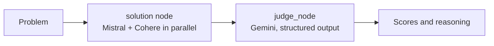

# LangGraph Battle Arena

Two LLMs answer the same problem, and a third one judges them.

You type a problem, for example "write a function for the Fibonacci sequence". Mistral and Cohere each answer
it, both answers stream into the UI side by side, and Gemini scores each one from 0 to 10 with written
reasoning. The verdict comes back as structured output validated by a Zod schema, not free text.

## How it works



- **`Backend/src/ai/graph.ai.ts`** is a LangGraph `StateGraph` with typed state (`StateSchema` + Zod) and two
  nodes. `solution` calls Mistral and Cohere in parallel with `Promise.all`. `judge_node` calls Gemini through
  `withStructuredOutput`, which returns `solution_1_score` and `solution_2_score` (0–10) plus reasoning for each.
- **`POST /invoke`** is the endpoint the UI uses. It streams each model's answer over Server-Sent Events as
  tokens arrive (`solution_1_chunk`, then `solution_2_chunk`), runs the same Gemini judge on the complete
  answers, and sends the verdict as the final event.
- **`GET /`** runs the compiled graph end to end on a sample problem and returns the final state as JSON.
- **Frontend** (React, Vite, Tailwind CSS) reads the SSE stream and renders both solutions, a score ring per
  solution and the judge's verdict.

## Stack

TypeScript, Node.js, Express 5, LangGraph, LangChain (`@langchain/mistralai`, `@langchain/cohere`,
`@langchain/google`), Zod, React, Vite, Tailwind CSS.

Models: Mistral `mistral-medium-latest` and Cohere `command-a-03-2025` answer; Gemini `gemini-flash-latest`
judges.

## Run it locally

Backend, on port 3000. Create `Backend/.env` with your keys first:

```bash
GOOGLE_API_KEY=...
MISTRAL_API_KEY=...
COHERE_API_KEY=...
```

```bash
cd Backend
npm install
npm run dev
```

Frontend, on port 5173:

```bash
cd Frontend
npm install
npm run dev
```

Open http://localhost:5173 and enter a problem.

## Notes

- The UI streams the two answers one after the other so each can render live; the graph in `graph.ai.ts`
  runs them in parallel. Both paths use the same judge prompt and schema.
- `STREAMING_IMPLEMENTATION.md` has the original notes on the streaming UI.
